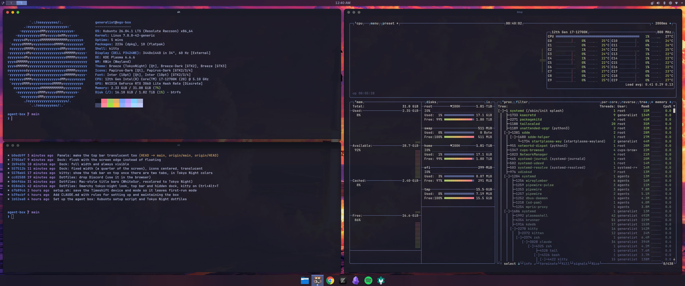
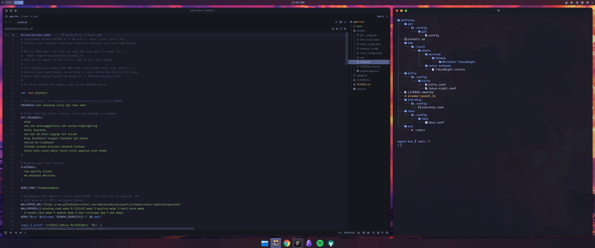
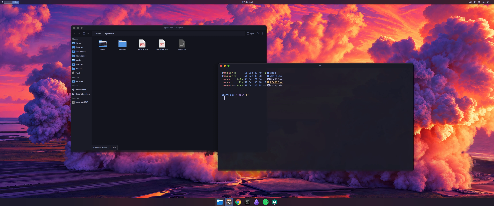

# Agent box

Turns the home PC (i7 12th gen, 32 GB, 2 TB SSD, RTX 3060) into an always-on
machine that runs coding agents on your own projects, next to a desktop you
still use every day.

- **OS:** Kubuntu 26.04 LTS.
- **Snapshots:** Timeshift. A daily and weekly schedule, plus a snapshot before every risky upgrade.
- **Access:** Tailscale SSH from the Mac or the phone. No ports open to the internet.
- **Agents:** run as a separate `agents` user, capped at 24 GB of RAM and low CPU
  priority, so the desktop stays usable.



<p>
  
  
</p>

## 1. Before you install

1. **Copy anything you want to keep off the PC.** The install erases the disk.
2. In the BIOS, set **Restore on AC power loss** to **Power On**.
3. On the Mac, download the **Kubuntu 26.04 LTS** ISO and write it to a USB stick
   with balenaEtcher.

## 2. Install Kubuntu

1. Boot the PC from the USB stick and choose **Install Kubuntu**.
2. **Do not tick the option to install third-party graphics drivers.** The
   open-source driver runs the desktop fine. The NVIDIA driver is what broke
   your peripherals last time; add it later, after a snapshot, only if you need
   it (see section 7).
3. Disk: choose **Erase disk**. If the installer offers a file system choice,
   pick **btrfs** (snapshots become instant). If not, ext4 is fine
   (snapshots take a few minutes).
4. Create your own user (not `agents`; the script makes that one).

## 3. Run the setup script

This repo is private, so sign in to GitHub to clone it. Use your own account;
this login is for your user only, never for `agents`.

```sh
sudo apt install -y git gh
gh auth login                     # GitHub.com, HTTPS, log in with a browser
gh repo clone gendev1/agent-box ~/agent-box
cd ~/agent-box
sudo bash setup.sh
```

It takes about 10 minutes and ends with a snapshot named "agent box set up".
You can run it again at any time; it skips what is already done.

### Make the desktop nice (dotfiles)

The `dotfiles` folder holds your own configs, in Omarchy's tokyo-night look: dark
navy, soft text and blue accents. It lives in
git at `~/agent-box`, so every change has a history: commit and push after you
change something.

```sh
bash ~/agent-box/dotfiles/install.sh     # as your own user, not with sudo
```

Then log out and back in. It installs the tools and links the configs into
your home folder with GNU Stow: `~/.zshrc` is a link to
`dotfiles/zsh/.zshrc`, so editing one edits the other. Files that were already
there move to `~/.dotfiles-backup/`.

| Folder | What it holds |
| --- | --- |
| `zsh/` | Shell: autosuggestions, highlighting, Ctrl+R fuzzy history, ↑ searches by prefix, aliases |
| `starship/` | A quiet Tokyo Night prompt: folder, git, Go version |
| `kitty/` | Terminal: Tokyo Night colors, JetBrains Mono Nerd Font |
| `git/` | Delta diffs, rerere, auto upstream on push, recent branches first |
| `tmux/` | Alt+Enter splits, Alt+1–9 windows, status bar on top |
| `kde/` | The Tokyo Night color scheme and the Mac-style title bar |

KDE and btop rewrite their own config files, so `install.sh` sets those
with commands instead of links:

- **Colors and wallpaper:** Omarchy's tokyo-night theme: its colors and its
  wallpapers (pick another in the wallpaper settings).
- **Icons:** Papirus Dark. Omarchy's Yaru icons are made for GNOME and leave
  KDE's panel icons blank.
- **btop, bat and git diffs:** the Tokyo Night themes. The bat theme is
  downloaded from folke/tokyonight.nvim.
- **Fonts:** Inter for the interface, JetBrains Mono for code.
- **Desktop:** a thin bar on top and a full-width dock at the bottom, both
  always visible. The layout is set once (`plasma-layout.js`),
  so later changes in the panel settings are kept.
- **Terminal:** kitty, also on Ctrl+Alt+T.
- **Windows:** Mac-style title bars (WhiteSur, recolored to Tokyo Night): red,
  yellow and green buttons on the left. The screen never locks or sleeps on its own.
  Apps that draw their own title bar ignore this; switch them to the system
  title bar: Chrome (Settings → Appearance → "Use system title bar and borders")
  and Obsidian (Settings → Appearance → Window frame style → Native frame).

Zed is not themed by the script. In Zed, open Extensions, install
**Tokyo Night**, then pick it with Ctrl+K Ctrl+T.

**To change something:**

1. Edit the file in `~/agent-box/dotfiles` (or through its link).
2. Commit it.
3. To add a tool, add it to the lists at the top of `install.sh` and run it again.

Machine-only settings and secrets go in `~/.zshrc.local` and
`~/.gitconfig.local`, which are not in the repo.

**Useful commands:**
- `ff` finds a file with a preview, and `eff` opens the result in your editor.
- `ga <branch>` makes a git worktree, and `gd` removes it.
- `t` attaches to tmux.
- `lg` opens lazygit, and `top` opens btop.
- `dots` goes to your dotfiles.
- `agents` switches to the agents user.

Several defaults (git, tmux, aliases) are adapted from
[Omarchy](https://github.com/basecamp/omarchy) under the MIT license; see
`dotfiles/LICENSE-omarchy`.

### The Mac feel

`install.sh` already sets the parts that can be scripted:

- **Text:** grayscale smoothing and light hinting, the way a Mac renders text.
- **Motion:** animations 30% shorter, and the genie effect when you minimize.
- **Windows:** large, soft shadows, so the active window stands out.
- **Dock:** a translucent, full-width dock with the app icons centered.
- **Keyboard:** fast key repeat.

The rest you do by hand, and it matters more than any theme:

1. **Shortcuts in the same place.** On a PC keyboard, Alt sits where Cmd is
   on a Mac. KDE already uses that spot well:
   - **Alt+Space** opens KRunner, the equivalent of Spotlight;
   - **Meta+W** opens Overview, the equivalent of Mission Control.

   For Cmd+C, Cmd+V, Cmd+Tab and so on with the same fingers as on the Mac,
   install **Toshy** (github.com/RedBearAK/toshy). It remaps Mac shortcuts on
   Linux, app by app, and handles terminals correctly. It runs as a service, so
   take a snapshot first.
2. **Natural scrolling.** System Settings → Mouse & Touchpad → "Invert scroll
   direction".
3. **The screen.** Use 100% or 200% scaling, not 125% or 150%. A high-resolution
   (4K) monitor at 200% looks the most like a Mac.
4. **A trackpad, if you have one.** An Apple Magic Trackpad works on KDE with
   Wayland: three- and four-finger swipes for Overview and switching desktops.
5. **Restraint.** Pick the setup once and leave it. Constant tweaking is the
   opposite of the Mac.

Skip KDE's global menu bar (the menu at the top of the screen). Many apps,
such as Electron and GTK apps, do not support it, and a menu bar that is
sometimes empty feels less like a Mac than no menu bar.

**Rounded window corners.** Breeze rounds all four corners since Plasma 6.5,
so Kubuntu 26.04 should look rounded out of the box. If the bottom corners
are square, install **Klassy** (a window decoration with adjustable corners)
from its GitHub releases. Avoid KWin effects that must be rebuilt after each
Plasma update unless you take a snapshot first.

To undo the look: System Settings → Colors & Themes → Global Theme → Breeze.

## 4. Connect Tailscale

```sh
sudo tailscale up --ssh
```

Open the link it prints and sign in with **the same account as the Mac**, so
both are on one tailnet. After that, from the Mac:

```sh
ssh <your-user>@<pc-name>
```

## 5. Set up the agents user

```sh
sudo -iu agents
```

1. **Git identity.** Use a bot name so agent commits are easy to tell apart:
   ```sh
   git config --global user.name  "<your name> agent"
   git config --global user.email "<bot email>"
   ```
2. **GitHub token.** Create a fine-grained token at
   github.com → Settings → Developer settings → Fine-grained tokens:
   - Repository access: **only** the repos the agents work on, plus read-only
     access to your agent runner's repo if it is private.
   - Permissions: Contents (read/write), Issues (read/write), Pull requests
     (read/write), Checks (read), Commit statuses (read), Metadata (read).
   - Set an expiry date.
   ```sh
   gh auth login --with-token < token.txt && rm token.txt
   gh auth setup-git
   ```
3. **Model access.** Run `claude` once and sign in. For opencode, run
   `opencode auth login`. Set a **monthly spend limit** in the Anthropic and
   OpenAI consoles before anything runs unattended.
4. **No personal logins** in this account: no browser sessions, no personal
   SSH keys, no tokens for repos the agents do not work on.

## 6. Start the agent runner

As `agents`, clone and build whatever runs your agents (Bun, Go, Claude Code
and opencode are already installed), then start it as systemd user services.
Lingering is already on, so they keep running after you log out.

- Start with **1 worker** per project. Go up to **3 in total** once it is stable.
  Each worker is an agent session plus builds and tests, about 6–8 GB.
- Give each repo a check the agents must pass before anything merges, such as
  a `make verify` target.
- Watch memory with `htop`.

Private details (which projects, which runner) go in `README.private.md`,
which is not in git.

## 7. Snapshots and recovery

**What happens automatically:**
- A daily snapshot (5 kept) and a weekly one (3 kept).
- Security updates install themselves.

Snapshots cover the system, not `/home`; your code lives on GitHub.

**For anything risky** (drivers, kernels, big upgrades):

```sh
sudo upgrade-safely
```

It takes a snapshot first, then upgrades.

**If something breaks:**

1. **The desktop or peripherals are broken, but the PC boots.** Press
   Ctrl+Alt+F3 for a text login, or SSH in from the Mac over Tailscale. Then:
   ```sh
   sudo timeshift --restore
   ```
   Pick the snapshot from before the change, then reboot.
2. **The PC does not boot.** Boot the Kubuntu USB stick and choose **Try
   Kubuntu**. Then:
   ```sh
   sudo apt install timeshift
   sudo timeshift-launcher
   ```
   Choose **Restore** and pick the snapshot.
3. **Snapshots are on the same disk.** They undo bad updates; they do not
   protect against a dead SSD.

**If you ever want the NVIDIA driver** (for local models):

```sh
sudo timeshift --create --comments "before nvidia" --tags O
sudo ubuntu-drivers install
sudo reboot
```

If the mouse, keyboard or display break, restore "before nvidia" as above.
If it works, run `sudo bash setup.sh` again: it sees the driver and stops
automatic updates for NVIDIA and the kernel, so they only change together,
through `sudo upgrade-safely`.

## Checks

```sh
sudo timeshift --list                                 # snapshots
systemctl status user-$(id -u agents).slice           # agent memory use
sudo -iu agents tmux ls                               # running agent sessions
tailscale status                                      # devices on the tailnet
```

## License

MIT; see [LICENSE](LICENSE). Two parts come from other projects and keep
their own licenses:

- Several defaults (git, tmux, aliases) are adapted from
  [Omarchy](https://github.com/basecamp/omarchy), MIT; see
  `dotfiles/LICENSE-omarchy`. The wallpapers are not in this repo:
  `install.sh` downloads them from Omarchy's tokyo-night theme.
- The title bar theme in
  `dotfiles/kde/.local/share/aurorae/themes/WhiteSur-TokyoNight/` is a
  recolored copy of [WhiteSur-kde](https://github.com/vinceliuice/WhiteSur-kde),
  GPL-3.0; see the LICENSE in that folder.
